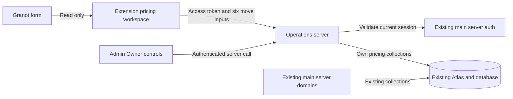

# Transportation pricing specification packet

Start with [SPECIFICATION.md](SPECIFICATION.md) for the complete proposed data model, calculation rules, configuration lifecycle, APIs, authorization, Owner controls, errors and acceptance criteria. [EXTENSION.md](EXTENSION.md) supplies the source-backed Granot selectors, frame handling, display, freshness, permissions and browser test plan.

The user's hosting decision supersedes the initial review's proposal to append pricing to the main server. The new runtime is the independent `vantage-operations-server`, deployed to [Vercel production](https://vantage-operations-server.vercel.app). Existing behavior remains where it is. The first release implements the Owner's transportation policy; broad move-price prediction remains later research.

Supporting documents:

- [PLAN.md](PLAN.md): implementation sequence and remaining policy decisions.
- [Database recommendation](../DATABASE-DECISION.md): same cluster versus same database, ownership and backup implications.
- [Deployment evidence](../DEPLOYMENT.md): current scaffold status and checks.
- [Environment inventory](../environment.md): configuration the user supplies.

## Boundaries

Scaffolding and deployment are complete. Pricing runtime, Owner controls and extension changes are not implemented by this packet. Commercial defaults that the Owner has not supplied or approved remain explicitly marked for decision; illustrative prices are never production seed data.
