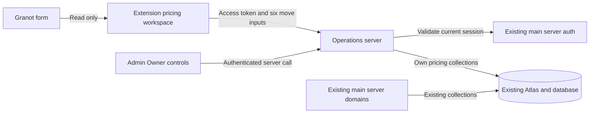

# Transportation pricing specification packet

Start with [SPECIFICATION.md](SPECIFICATION.md) for the complete proposed data model, calculation rules, configuration lifecycle, APIs, authorization, Owner controls, errors and acceptance criteria. [EXTENSION.md](EXTENSION.md) supplies the source-backed Granot selectors, frame handling, display, freshness, permissions and browser test plan.

The user's hosting decision supersedes the initial review's proposal to append pricing to the main server. The new runtime is the independent `vantage-operations-server`, deployed to [Vercel production](https://vantage-operations-server.vercel.app). Existing behavior remains where it is. The first release implements the Owner's transportation policy; broad move-price prediction remains later research.

Supporting documents:

- [PLAN.md](PLAN.md): implementation sequence and remaining policy decisions.
- [Database recommendation](../DATABASE-DECISION.md): same cluster versus same database, ownership and backup implications.
- [Deployment evidence](../DEPLOYMENT.md): current scaffold status and checks.
- [Environment inventory](../environment.md): configuration the user supplies.
- [Unspecified workflows](UNSPECIFIED-WORKFLOWS.md): the user's acknowledged Sales rep lock-in submission and final document write gaps; no writeback is claimed.

## Boundaries

The pricing runtime, Owner controls and extension workspace are implemented locally and reconciled on October 26, 2026. Operations and Admin were deployed October 26, 2026; production control remains disabled with no active revision. Extension release status is recorded in the runbook. See the [implementation ledger](workspace/IMPLEMENTATION-CHECKLIST.md), [independent QA](workspace/QA-EVIDENCE.md), and [local/release runbook](workspace/RELEASE.md). Commercial defaults remain proposals until approved; illustrative prices are never production seed data.
